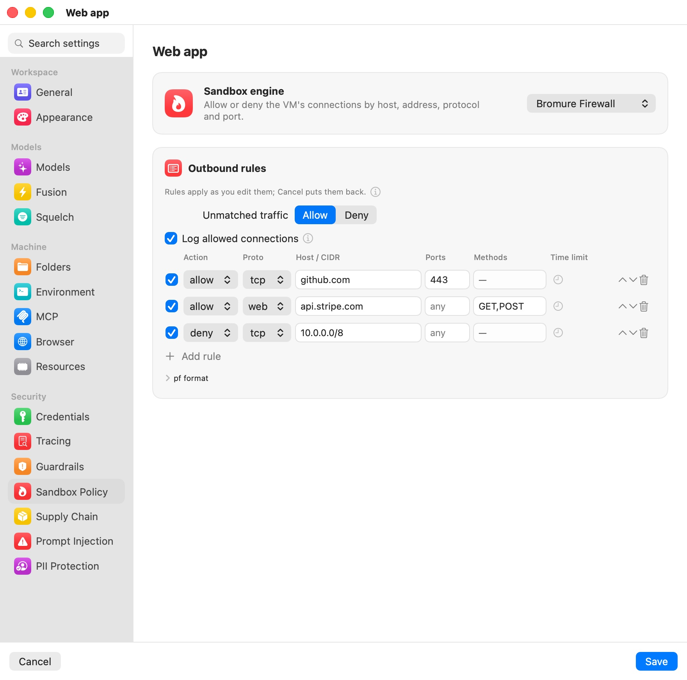
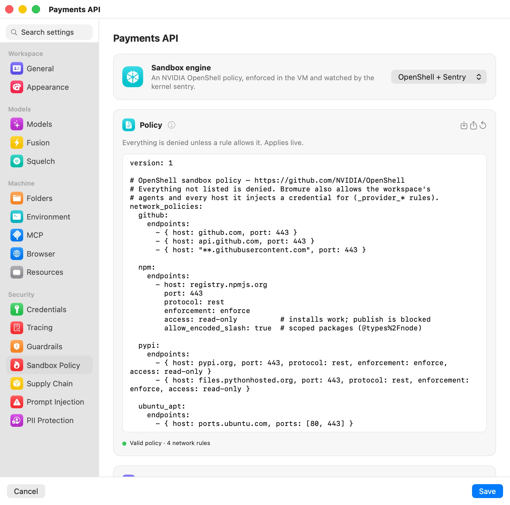

# Sandbox Policy

The **Sandbox Policy** pane (in the **Security** group, between Guardrails and Supply Chain) decides what a machine's VM may reach and, with the OpenShell engine, what its agents may do inside the VM (a machine is a workspace, in the settings editor). It was called **Firewall** before 5.4; searching the settings for `firewall`, `openshell`, `sentry` or `landlock` still finds it.

The pane opens on one choice, **Sandbox engine**:

| Engine | What it is |
|---|---|
| **Bromure Firewall** | "Allow or deny the VM's connections by host, address, protocol and port." An ordered allow/deny rule table, enforced on the Mac. The default for a new machine. |
| **OpenShell + Sentry** | "An NVIDIA OpenShell policy, enforced in the VM and watched by the kernel sentry." A YAML policy (deny by default) plus the guest sandbox and the kernel sentry. |

How the engines work, and how they fit with the rest of Bromure's protections, is explained in [Sandbox Policy, the Guest Sandbox & the Kernel Sentry](../10b-sandbox-policy.mdx). This page is the field reference.

Switching to **OpenShell + Sentry** fills an empty policy with your organization's default policy (or Bromure's starter policy) and turns the kernel sentry on in **Best effort**. Switching back to **Bromure Firewall** while a policy exists asks first, **Switch to the Bromure Firewall?**, because **Discard OpenShell policy** removes the policy and turns the kernel sentry off (unless your organization requires it). Use **Export…** first if you want to keep the policy.

The protections that apply to either engine — telling the agent when policy blocks it, the agent watchdog, strict credentials, transparent interception and the insecure bypass — are in [Guardrails › Protections](guardrails.mdx#protections).

## Bromure Firewall

<p align="center">
  
</p>

### Outbound rules

"Allow or deny the VM's connections by host, IP/CIDR, protocol and port — matched top to bottom, first match wins." Rules cover any protocol and any destination. **Unmatched traffic** sets what happens to a connection no rule matches: **Allow** (default) or **Deny** for an allow-list setup. **Add rule** appends a row.

| Column | Values | Meaning |
|---|---|---|
| (checkbox) | on / off | Untick a rule to switch it off without deleting it. A switched-off rule is kept, dimmed, and ignored until you tick it again. |
| **Action** | `allow` / `deny` | What happens to a match. |
| **Proto** | `tcp` / `udp` / `web` / `any` | `web` is HTTP(S), the only protocol whose rules can also restrict methods. |
| **Host / CIDR** | `any`, a hostname, or an IPv4 CIDR | `example.com` covers the domain and all subdomains; `*.example.com` subdomains only. A bare IP is a /32. |
| **Ports** | `any`, a port, a range (`8000-8999`) or a list | Empty means any. |
| **Methods** | HTTP verbs, `web` rules only | With `allow`, only these verbs pass (`GET,POST`); with `deny`, these verbs are refused (`PUT,DELETE`). `read-only` means GET/HEAD/OPTIONS. |
| **Time limit** | clock menu | Turn the rule on for a limited time: **On for 15 minutes**, **On for 1 hour** or **On until the workspace stops**; **Make permanent** removes the limit. A timed rule shows its time left ("14m"), an until-stop rule shows "until stop". |

"Rules apply as you edit them; Cancel puts them back." There's no restart and no Save needed: new connections follow the new rules at once, and so do the ones already open. Switching a rule off, removing it, adding a deny rule, a time limit running out, or an until-stop rule ending all re-check every open connection of the machine, and the ones the new rules deny are cut on both sides. Switching off a temporary allow really ends the access, rather than leaving an open download running to completion.

- Connections made through the proxy settings (`HTTPS_PROXY` — curl, git, npm and the agents use them by default) are cut by the proxy itself: it closes the VM's side and cancels the request to the server, WebSockets included. The Security Timeline records each one as *connection closed — “allow tcp …” no longer allows it*.
- Direct connections are cut by the virtual switch on their next packet: it drops it and sends the VM a TCP reset, and for intercepted HTTP(S) traffic the proxy's connection to the server is closed too.

If the rules change outside the editor while it's open — a Security Timeline action, or a time limit running out — the change is merged into your unsaved edits. If you had edited the same rules, the pane asks: **Reload** or **Keep my edits**.

### Temporary rules

Some rules are only needed for a moment — reaching GitHub or the npm registry long enough to upgrade dependencies, for example. Rather than adding the rule and remembering to delete it, set a time limit with the rule's clock menu:

- **On for 15 minutes** / **On for 1 hour** — the rule stops matching the moment the time is up, even if Bromure is busy; shortly after, it is switched off and saved that way, so it stays in the list for next time.
- **On until the workspace stops** — the rule is switched off when the machine stops (or restarts), and at the next launch of Bromure if it was still running when the app quit.

To use the rule again later, tick it or pick a new time limit.

The quickest way to allow something that was just blocked is the [Sandbox drawer](../10b-sandbox-policy.mdx#the-sandbox-drawer) in the machine's window, or **Allow…** on the blocked row of the [Security Timeline](../11a-security-timeline.mdx#firewall-quick-actions). Both offer **Always**, **For 15 minutes**, **For 1 hour** and **Until the workspace stops**.

### pf format

The **pf format** disclosure shows the same rules as text — one per line, ending in `default allow` or `default deny` — which is how they are stored and what the CLI and managed profiles use:

```
allow tcp api.github.com:443
allow web api.example.com GET,POST     # only these verbs reach the site
deny  web api.internal PUT,DELETE      # block these verbs, allow the rest
deny  udp any:53
deny  any 10.0.0.0/8
default deny
```

Switched-off and temporary rules carry a short note in a comment, so the text stays plain pf:

```
#@off allow tcp registry.npmjs.org:443          # switched off
allow tcp github.com:443 #@until=1767225600      # on until this time (Unix seconds)
allow tcp pypi.org:443 #@until=stop              # on until the machine stops
```

Enforcement happens on the Mac, in two layers: the virtual network switch checks every connection by destination IP and by the hostname seen in DNS (all protocols), and the proxy checks again by TLS server name and, for `web` rules, by HTTP method. That is what lets a machine read an API it may not write to: `allow web api.example.com GET,POST` gives the agent queries without changes, whatever tool it uses.

Every decision is recorded in the [Security Timeline](../11a-security-timeline.mdx), with the rule that decided it, and on enrolled Macs sent to your organization.

### Log allowed connections

Blocked connections are always recorded. **Log allowed connections**, under the **Unmatched traffic** choice, decides whether the connections the firewall lets through are recorded too — which is what gives their rows the **Block…** and **Rule…** quick actions. Until you choose, it is on while the machine has rules (or denies unmatched traffic) and off for a machine with no firewall, so a machine without rules doesn't fill the Timeline with "allowed" rows.

Allowed connections stay low-noise either way: one row per destination (host, port and protocol — a host behind several addresses is one row) at most once a minute, and repeats fold into the previous row with a count. The on-Mac local-models endpoint is never listed.

> **Note:** Local models are always reachable: an allow rule for the on-Mac inference endpoint is placed ahead of your rules, so even `default deny` can't cut agents off from an on-device model.

### Kernel sentry under the firewall

The kernel sentry belongs to the OpenShell engine. A machine still running it under the Bromure Firewall shows a **Kernel sentry is still on** card with **Turn off**, or — when your organization requires the sentry — "Your organization requires at least …" and no control.

## OpenShell + Sentry

<p align="center">
  
</p>

The engine's settings are laid out in five cards.

### Policy

"Everything is denied unless a rule allows it. Applies live." The card holds the policy itself: an [NVIDIA OpenShell](https://github.com/NVIDIA/OpenShell) sandbox policy, schema version 1, in YAML. Connections are allowed only by a `network_policies` rule; an endpoint with a `protocol` is inspected request by request, where `enforce` blocks and `audit` only records. Changes apply to a running machine without a restart.

The card's buttons:

- **Import…** — replace the policy with a `.yaml` / `.yml` file.
- **Export…** — save it as `<machine>-policy.yaml`.
- **Reset to starter policy** — the starter allows GitHub (`github.com`, `api.github.com`, `**.githubusercontent.com` on 443), npm and PyPI read-only (inspected, enforce), and Ubuntu's package mirrors on 80/443.

Below the editor, a check line reads **Valid policy · N network rules** (green) or the parse error (red), followed by any warnings. With **Enforce binaries** on, rules that list no `binaries` are called out in orange: they allow nothing.

### Kernel sentry

"Streams security events (process launches, privilege changes, module and BPF loads, sandbox denials) from the VM's kernel to Bromure, outside anything the agent can stop; after it starts, the kernel is locked so not even root in the VM can load code to interfere." Silence or a gap in the stream counts as tampering for the [agent watchdog](guardrails.mdx#protections).

| Mode | Behavior |
|---|---|
| **Best effort** | The machine runs with the sentry when its module loads, and without it otherwise. Chosen when you switch to OpenShell. |
| **Required** | Nothing runs in the VM until the sentry has settled: loaded, or reported why it can't load. The kernel is locked down further (which also rules out kernel tracing tools such as `bpftrace` and `perf`), and a sentry that never connects without a reason counts as tampering. |

**Mode** applies at the next VM start. When your organization sets a minimum, the stricter of the two applies, and **Best effort** is greyed out under a **Required** minimum ("Your organization requires it."). A machine set up before the sentry came with the engine shows **Off for this workspace** with **Turn on**.

The card's status line says **Connected · kernel *version*** or **Not connected**, how many events were dropped under load, if any, and **Couldn't start: *reason*** in red when the VM couldn't load the sentry. See [the kernel sentry](../10b-sandbox-policy.mdx#the-kernel-sentry) for how its modules are delivered.

### Sandbox

The card's title turns orange, **Sandbox ⚠︎**, when the VM reports a problem: the filesystem sandbox or the strict sandbox didn't apply, the sentry is unavailable while it's expected, or the guest sent warnings.

| Setting | Default | What it does |
|---|---|---|
| **Enforce binaries** | Off | "Rules apply only to the programs they list; the agent loses sudo and Docker." A root-owned attestor in the VM reports the program behind every connection, and a rule's `binaries` must name it. Each program's hash is pinned on first use, and a changed binary is refused. Agents get no path to root: no sudo, no Docker, and all traffic goes through transparent interception. Takes effect at the next VM start. Locked on when your organization or the policy's `process` section requires it. |
| **Filesystem & process** | From the policy | "The agent can only reach the paths the policy lists." Enforced in the VM with Landlock from the policy's `filesystem_policy` and `process` sections; not even root can lift it. With neither section, the row reads "Not confined" and offers **Insert template**, which appends a typical `filesystem_policy` (read-only system folders, read-write home and `/tmp`). Takes effect at the next VM start. |
| **Packages in the home folder** | On | "pip installs into ~/.local; npm already uses ~/.npm-global." The sandbox has no root, so system-wide installs can't work. Takes effect in new terminals. |
| **System packages on request** | On | "apt-get install asks you first; the agent never gets root." The request waits in the [Sandbox drawer](../10b-sandbox-policy.mdx#packages-without-root); approve it and Bromure installs exactly those packages from Ubuntu's mirrors. Takes effect at the next VM start. |

The status lines under **Enforce binaries** and **Filesystem & process** say what the VM actually applied:

- **Attestor connected: binaries are enforced**, or **Attestor not connected: until it is, only Bromure's own rules apply**.
- **Filesystem** followed by its state, who the agent runs as, and the Landlock version, or **Filesystem not applied yet** before the VM reports.
- The paths Bromure adds for its own plumbing (**Added for Bromure: …**).
- When the filesystem is confined but binaries aren't enforced: "The agent keeps sudo, so it could stop Bromure's processes in the VM. Turn on Enforce binaries to prevent that."
- In red, when the strict sandbox didn't apply: "no session will start and binary rules fail closed. Restarting the VM retries it."

### Policy advisor

When a request is blocked, the agent can propose the narrow rule it needs at `http://policy.local` (OpenShell's advisor API) and wait for your decision. Blocked connections are drafted as proposals here too.

| **Agent proposals** | Behavior |
|---|---|
| **Off** (default) | The agent can't propose rules. Blocked connections are still drafted as proposals. |
| **Ask me** | Every proposal waits for you. |
| **Approve if risk-free** | Proposals with no risk finding are approved at once. A proposal that reaches a host where the machine has a credential, adds a method there, or uses a wildcard, a private address, a database or a high port always waits for you. |

Each pending proposal shows its rule and destination, whether it was **drafted from a block** or **proposed by the agent**, the agent's stated intent, the YAML, and any risk findings in orange. Type a **Reason (sent to the agent on reject)** if you like, then **Reject** or **Approve**. An approved rule is added to the policy and applies live. **Recent decisions** lists the last five. The same proposals appear in the [Sandbox drawer](../10b-sandbox-policy.mdx#the-sandbox-drawer).

### Governance

- **Organization boundary** — the most any machine's policy may allow. It is **Set by your organization (bromure.io)**, **Set on this Mac** (with **Set from file…** and **Clear**), or **None set.** Every save that changes a policy is checked against it, with NVIDIA's `openshell-prover` when it is installed, otherwise with Bromure's built-in check. A policy outside the boundary is refused with the boundary's summary, wherever it was edited — the pane, the Sandbox drawer, the advisor or the API.
- **Revision history** — each save that changes the policy is kept as a version (**vN**, with its date, where the change came from, and a short hash). **Restore** loads a version back into the editor.
- **Rules Bromure adds automatically** — like OpenShell's provider rules, these keep the machine's agents and every credential it configures reachable. They're not part of the exported policy.

## What the agent sees when it's blocked

A connection the policy refuses fails at once, with no hung socket. Under an OpenShell policy, a refused proxied connection or inspected request gets HTTP 403 with OpenShell's own `policy_denied` body: the layer, the host and port (or the method and path), and the rule or the reason. When the policy advisor is on, the body also tells the agent how to propose a rule at `http://policy.local`. With **Tell the agent when policy blocks it** on (see [Guardrails](guardrails.mdx#protections)), the agent is also told, in its conversation, what it tried, that policy forbids it, and to ask you instead of working around it.

## Settings reference

| Setting | Type | Default |
|---|---|---|
| **Sandbox engine** | **Bromure Firewall** / **OpenShell + Sentry** | Bromure Firewall |
| **Unmatched traffic** (firewall) | **Allow** / **Deny** | Allow |
| **Log allowed connections** (firewall) | Checkbox | On while the machine has rules |
| Rules (firewall) | Ordered table (**Add rule**), also shown as **pf format** | None |
| Policy (OpenShell) | YAML, schema v1 | Organization default, or the starter policy |
| Kernel sentry **Mode** | **Best effort** / **Required** | Best effort under OpenShell; off under the firewall |
| **Enforce binaries** | Toggle | Off |
| **Packages in the home folder** | Toggle | On |
| **System packages on request** | Toggle | On |
| **Agent proposals** | **Off** / **Ask me** / **Approve if risk-free** | Off |
| **Organization boundary** | File, or set by your organization | None |

The rule table and the policy editor aren't shown in the iPhone, iPad or Vision Pro client ("Outbound connection rules are edited on the Mac that runs this workspace."); rules and policies set on the Mac still apply.

## Related chapters

- [Sandbox Policy, the Guest Sandbox & the Kernel Sentry](../10b-sandbox-policy.mdx) — how the engines work.
- [Guardrails](guardrails.mdx) — credential policies and the protections shared by both engines.
- [Credentials](credentials.mdx#openshell-provider-profiles) — OpenShell provider profiles and credential placeholders.
- [Security Overview & Timeline](../11a-security-timeline.mdx) — every block and allow, per machine, and network lineage.
