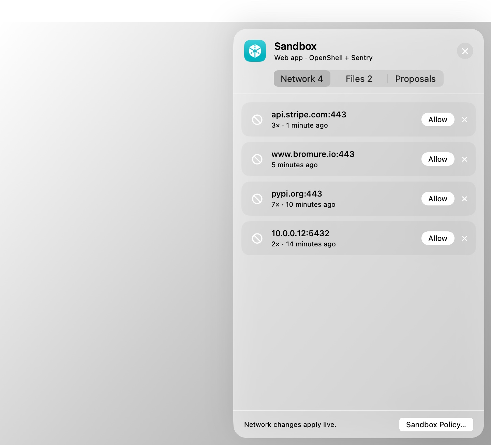

# Sandbox Policy, the Guest Sandbox & the Kernel Sentry

Every machine already runs behind the wire boundary: the agent only ever holds stand-in credentials, and everything it sends crosses Bromure's proxy and virtual switch on the Mac (see [Credentials & the Wire Boundary](08-credentials.mdx)). **Sandbox Policy** decides what else a machine may do — where its VM may connect and, if you want, what its agents may touch inside the VM. A machine (a workspace, in the settings editor) picks one of two **sandbox engines** in [Settings › Sandbox Policy](07-settings/sandbox-policy.mdx):

| | **Bromure Firewall** | **OpenShell + Sentry** |
|---|---|---|
| What you write | An ordered allow/deny rule table (pf style), with an optional default deny | An [NVIDIA OpenShell](https://github.com/NVIDIA/OpenShell) sandbox policy (YAML, schema v1) |
| Default for unmatched traffic | Allow (or Deny) | Deny |
| Request inspection | HTTP methods per host (`web` rules) | REST, WebSocket, GraphQL, MCP and JSON-RPC, request by request, in `enforce` or `audit` |
| Inside the VM | Nothing | The **guest sandbox** (filesystem, process, binaries), the **kernel sentry**, packages without root |
| Getting unblocked | Timed rules, Security Timeline quick actions, the Sandbox drawer | The Sandbox drawer, the **policy advisor** at `http://policy.local` |
| Best for | Narrowing a machine's network without changing how it works | A machine you want confined, observed and auditable end to end |

New machines start on the Bromure Firewall. Both engines are enforced on the Mac, where the agent can't reach, and every decision is a row in the [Security Timeline](11a-security-timeline.mdx).

Five protections work under either engine and live in [Guardrails › Protections](07-settings/guardrails.mdx#protections):

- telling the agent when policy blocks it;
- the agent watchdog;
- strict credential mode;
- transparent interception;
- the per-request insecure bypass.

## The Bromure Firewall

The firewall is a list of rules over every connection the VM opens: host, IP/CIDR, protocol, port, and for web traffic the HTTP method. The rules are matched top to bottom, first match wins, and rules can be switched off or turned on for a limited time. It is checked at the virtual switch (by destination address and by the name the VM looked up) and again in the proxy (by TLS server name, and for `web` rules by method). The VM's ports 80 and 443 are diverted into the proxy, so nothing inside can opt out. The rule syntax and editor are documented in [Sandbox Policy › Bromure Firewall](07-settings/sandbox-policy.mdx#bromure-firewall).

## OpenShell policies

[NVIDIA OpenShell](https://github.com/NVIDIA/OpenShell) is an open format for sandboxing AI agents: one YAML policy saying which endpoints an agent may reach, how its requests are inspected, which files it may touch, and which programs may do so. Bromure runs OpenShell policies natively. You can bring a policy written for OpenShell, or start from Bromure's starter policy, and get the same decisions. Bromure's evaluator was checked against OpenShell's own over 125,000 differential cases with no mismatch.

Choosing **OpenShell + Sentry** in a machine's settings loads your organization's default policy, or the starter policy (GitHub, npm and PyPI read-only, Ubuntu's package mirrors), and turns the kernel sentry on. From then on, **everything is denied unless a `network_policies` rule allows it.**

### Where the policy is enforced

| Where | What it decides |
|---|---|
| The virtual switch | Every connection by address and port (all protocols), and — with **Enforce binaries** — by the program that opened it. |
| TLS server name / HTTP `Host` | Which endpoint a connection belongs to, including connections that skip the proxy settings. |
| The proxy | Connections made through `HTTPS_PROXY`. |
| Each request | An endpoint with a `protocol` (`rest`, `websocket`, `graphql`, `mcp`, `json-rpc`) is inspected request by request: methods and paths (`access: read-only`, `read-write`, `full`, or explicit rules and `deny_rules`), query parameters, GraphQL operations, MCP tools and JSON-RPC methods. `enforcement: enforce` blocks; `audit` records and lets it through. |

Some destinations are refused whatever the policy says:

- loopback, link-local and cloud-metadata addresses;
- Kubernetes control-plane ports (2379, 2380, 6443, 10250, 10255).

Private ranges (10/8, 172.16/12, 192.168/16, 100.64/10) are reachable only through an exact hostname or `allowed_ips`. Network rules apply to a running machine at once. The filesystem, process and sentry settings take effect at the next VM start.

A refused request gets HTTP 403 with OpenShell's own `policy_denied` body, so tools and agents that understand OpenShell react the same way.

### Rules Bromure adds automatically

A machine still has to reach its agents' model providers, the hosts its credentials are for, its Kubernetes clusters, AWS, and its local models. Like OpenShell's provider rules, Bromure adds `_provider_…` rules for those. They're listed under **Rules Bromure adds automatically** in the Governance card, and left out of an exported policy.

### Credentials under OpenShell

Bromure's credential protection is unchanged: the VM holds stand-ins, and the real value is swapped in on the wire, only for the credential's own hosts. Two additions, in the [Credentials](07-settings/credentials.mdx#openshell-provider-profiles) pane of an OpenShell machine:

- **OpenShell provider profiles** — import a profile (`openshell profile export`), type in its values, and each one becomes a machine credential bound to the profile's hosts and paths, with the profile's endpoints added as a rule.
- **Use OpenShell credential placeholders** — the agent sees `openshell:resolve:env:NAME` instead of Bromure's look-alike tokens, as it would under OpenShell.

The policy's own credential fields (`credential_binding`, `credential_signing` and similar) are ignored with a warning: Bromure binds each credential to its hosts and signs AWS requests itself.

### Differences from OpenShell

Bromure follows OpenShell's semantics with a few deliberate differences:

- **No `filesystem_policy`, no filesystem sandbox.** A policy without that section leaves the VM's files unconfined; OpenShell would confine the agent to its working folder.
- **`binaries` needs Enforce binaries.** Without it, `binaries` is advisory, and the editor warns so: the agent holds root in the VM, so a process's identity can't be trusted.
- **Middlewares.** Only the built-in `openshell/regex` middleware in `redact` mode runs. An external middleware is passed through or blocked according to its `fail_open` / `fail_closed`.
- **Provider profiles.** Credentials that `refresh` or use a `token_grant` are used as static values.
- **Seccomp.** The filter is adjusted so job control works in the VM's terminals.

## The guest sandbox

The network policy limits where the VM can connect. The guest sandbox limits what the agents can do inside it. It comes from three parts of the policy:

| Policy section | What Bromure applies |
|---|---|
| `filesystem_policy` (+ `landlock`) | The agent can read and write only the paths the policy lists, enforced with Linux Landlock — even root in the VM can't lift it. `landlock.compatibility: best_effort` degrades if a path can't be used; `hard_requirement` fails closed. |
| `process` (`run_as_user`, `run_as_group`) | The agent runs as that account, with no sudo or Docker. It still sees `/home/ubuntu` as its home, so its configuration applies. |
| **Enforce binaries** (the strict sandbox) | Every connection is attributed to the program that made it by a root-owned attestor in the VM, and a rule's `binaries` must name it. Each program's hash is pinned on first use, and a changed binary is refused. To make that report trustworthy, the agent loses every path to root: no sudo, no Docker, and all traffic goes through transparent interception. |

Each part applies only if it is there. A policy with no `filesystem_policy` or `process` section confines nothing in the VM. A `process` section turns on Enforce binaries by itself.

| Configuration | What you get |
|---|---|
| Network policy only | The network is confined; the VM isn't. |
| `filesystem_policy`, binaries not enforced | Files are confined, even against root. sudo still works, so the agent could stop Bromure's helpers in the VM — the Sandbox card warns about it. |
| Enforce binaries, or a `process` section | Files, system calls and privileges are confined. The agent can't become root or interfere with Bromure's processes. |

Bromure adds the few paths its own plumbing needs, read-only unless they must be written, and lists them on the Sandbox card (**Added for Bromure: …**):

- the terminal sockets;
- the meta share;
- `/proc`;
- DNS configuration;
- the install folders of agents that live outside `/usr` (Grok in `/opt/grok`, Oh My Pi's runtime in `/opt/bun`).

They are never merged into your own lists.

### Fail closed

The sandbox never quietly falls back to running unconfined:

- If the strict sandbox doesn't fully apply, no session starts, binary rules refuse everything, and the Sandbox card says so in red. Restarting the VM retries it.
- Commands Bromure runs in the machine for you — terminals, `vm exec`, file operations, git, the planner — wait for the sandbox to be up (90 seconds for a plain command). If it doesn't come up, the command fails with `sandbox unavailable: …`.
- Bromure's own git calls in the machine always run confined, since a repository can point git at a program of its choosing.

### Packages without root

A confined agent has no root, so system-wide installs can't work. Two switches in the Sandbox card, both on by default, keep installs working:

- **Packages in the home folder** — `pip install` goes to `~/.local` (npm already installs globally into `~/.npm-global`). Bromure's own processes in the VM ignore packages in the home folder, so the agent can't plant code in them.
- **System packages on request** — when the agent runs `apt-get install` (with or without `sudo`), the request waits for you instead of failing. The agent sees:

  ```
  bromure: this sandbox has no root. Asked the user to approve installing: libpq-dev
  bromure: waiting for their decision (Sandbox drawer › Proposals)…
  ```

  Open the [Sandbox drawer](#the-sandbox-drawer)'s **Proposals** tab and choose **Install** or **Reject**. Approved packages are installed by the VM's root supervisor from Ubuntu's mirrors, by exact name only: no options, file paths, `.deb` files, or names apt would read as a pattern or a removal. A rejected request tells the agent not to retry. Each request and its outcome is a **Guest sandbox** row in the Security Timeline.

## The kernel sentry

The kernel sentry is a small Linux kernel module that reports, from inside the VM's kernel, what happens there. It reports to the Mac over a private channel the agent can't silence by killing a process:

- program launches;
- connections, with the process chain behind each one;
- privilege changes;
- module and BPF loads;
- everything the guest sandbox refused.

Once it has started, the kernel is locked down so not even root in the VM can load code to interfere.

The sentry is what makes these possible:

- **[Network lineage](11a-security-timeline.mdx#network-lineage)** — which prompt, tool call and process made each connection.
- **Sandbox refusals** in the Timeline and in the Sandbox drawer's **Files** tab.
- **Tampering detection** — a gap in the sentry's numbered stream, a disarmed probe, a forged reconnection, an unsigned module load or a lowered lockdown is flagged in red as **tampering suspected**, and feeds the [agent watchdog](07-settings/guardrails.mdx#agent-watchdog).
- **Binary identity** for Enforce binaries.

It has two modes, in the Kernel sentry card:

| Mode | At boot | If the sentry can't load |
|---|---|---|
| **Best effort** | The sentry loads in the background; sessions don't wait for it. | The machine runs without it, and the card says why. |
| **Required** | Nothing runs in the VM until the sentry has settled. The kernel is locked down further, which also rules out kernel tracing tools such as `bpftrace` and `perf`. | If the VM explains why (for example, no module exists for its kernel), the machine starts without it, with a warning. A sentry that never connects with no explanation is treated as tampering. |

Your organization can require a minimum mode. The machine then runs with the stricter of the two.

### Modules on demand

A kernel module only loads into the exact kernel it was built for, and a machine can `apt upgrade` into a new Ubuntu kernel at any time. So the modules don't ship in the app. Bromure builds them every day for every Ubuntu kernel and publishes them at `dl.bromure.io`. The catalog and every module are signed, and Bromure verifies the signature, the checksum, and that the catalog isn't older than one it already has.

- At launch, Bromure fetches the modules for the kernels your machines are known to run, and stages them before each boot.
- When a VM boots a kernel Bromure hasn't seen, the VM asks, and Bromure fetches the module and hands it over within seconds.
- When no module exists for that kernel yet, the VM is told at once, and the card reads **Couldn't start: no module published for *kernel* yet**. Try again a day later, or boot the previous kernel.

Downloaded modules are kept in `~/Library/Application Support/BromureAC/sentry-modules/`.

## The Sandbox drawer

<p align="center">
  
</p>

Every machine's window has a shield button in its toolbar ("Sandbox: what it blocked, ready to allow"). It opens the **Sandbox drawer** over the stage. You can also press ⌃⌘N, or choose **View › Toggle Sandbox Drawer**. A red badge on the button counts the destinations blocked since you last looked. The drawer shows what the machine's sandbox refused in the last two hours, ready to allow:

| Tab | Engine | What's in it |
|---|---|---|
| **Network** (**Blocked** under the firewall) | Both | Each blocked destination, with the program that tried (when known), how many times, and when. **Allow** adds a rule for that host and port. Under the firewall it offers **Always**, **For 15 minutes**, **For 1 hour** or **Until the workspace stops**. Under OpenShell with Enforce binaries, the rule names the program that tried. |
| **Files** | OpenShell, with a `filesystem_policy` | What the filesystem sandbox refused, grouped by folder, with the operation and file. **Allow** adds the folder read-only, or **Read and write**, or just that one file. File access changes at the next start: a **Restart** card appears. |
| **Proposals** | OpenShell | Package requests (**Install** / **Reject**) and rules the [policy advisor](#the-policy-advisor) is waiting on you for (**Approve** / **Reject**). |
| **Temporary** | Firewall | Rules on for a limited time, with when they end, and **End**. |

Rules you add from the drawer are saved to the machine and apply at once. They are checked against your [organization boundary](#organization-boundary) like any other edit. **Sandbox Policy…** at the bottom opens the machine's settings.

## The policy advisor

An agent that hits a wall usually knows exactly what it needed. Under OpenShell, it can ask for it: when a request is blocked, the agent can propose the narrowest rule that would allow it to `http://policy.local`, OpenShell's advisor API, and wait for your decision. The 403 it got tells it how. You choose how much it may do in **Sandbox Policy › Policy advisor › Agent proposals**:

| Mode | What happens |
|---|---|
| **Off** (default) | The agent can't propose rules. Blocked connections are still drafted as proposals for you. |
| **Ask me** | Each proposal waits in the Sandbox drawer and the Policy advisor card until you **Approve** or **Reject** it. A rejection's reason is sent back to the agent. |
| **Approve if risk-free** | A proposal with no risk finding is approved at once. A proposal that reaches a host where the machine has a credential, adds a method there, or uses a wildcard, a private address, a database port or a high port always waits for you. So does one that would exceed your organization's boundary. |

Agents may propose only `rest` or `websocket` rules, and never `tls: skip`. An approved rule is added to the policy, applies live, and is kept in the policy's revision history. Every proposal and decision is a **Firewall** row in the Security Timeline.

## Telling the agent: policy steering

An agent that only sees "connection refused" or "permission denied" tends to retry, then look for another way round. From the outside, that looks like an agent going rogue. With **Tell the agent when policy blocks it** (in [Guardrails › Protections](07-settings/guardrails.mdx#tell-the-agent-when-policy-blocks-it), on by default for OpenShell machines), the agent is told in its conversation what was blocked and why, for example:

> [Bromure policy] This workspace's network policy blocked connecting to `api.stripe.com:443` — no network policy allows `api.stripe.com:443`. … This is a deliberate restriction, not a fault: don't retry it or reach the same thing another way … If your task needs it, stop and tell the user what you need and why so they can decide.

- **Claude Code** gets the note right after the command that hit the block, mid-turn.
- **Codex, Grok, Kimi and Oh My Pi** get it typed in once their turn is over.
- The note goes to the agent whose process made the blocked connection or file access, using the kernel sentry's process chains.
- When Bromure can't tell which agent it was, a network block goes to every agent in the machine, and a file block only to a sole agent.
- The same block is told once per five minutes, and an agent gets at most five notes a minute. An agent's own background traffic, and common telemetry hosts, are never reported.

Values in the note that came from the VM (a host, a path) are quoted as data, so a program can't use a block to put words in the agent's mouth.

## The agent watchdog

The watchdog looks at a session as a whole, from outside the VM:

- bursts of blocks;
- credentials that don't belong;
- signs of sentry tampering;
- a sandbox that failed;
- prompt injection;
- new destinations after the session settled;
- outbound volume far above its baseline.

Past a threshold within a minute, it records a finding (**Alert**), or cuts the VM's network, pauses it, and asks you what to do (**Quarantine**). See [Guardrails › Agent watchdog](07-settings/guardrails.mdx#agent-watchdog). It is off by default; without it, tampering alarms are still recorded in the Security Timeline and in OCSF logs.

## Organization boundary

An organization can set a **boundary**: the most any machine's OpenShell policy may allow. It comes from bromure.io on an enrolled Mac (refreshed every ten minutes, and cached for offline use), or from a file on this Mac (**Sandbox Policy › Governance › Organization boundary**). Every save that changes a policy is checked against it, from the settings, the Sandbox drawer, the policy advisor or the API. Bromure uses NVIDIA's `openshell-prover` when it is installed, otherwise its own check.

- In the editor, a green or red verdict shows as you type ("within boundary", or "exceeds boundary: …" with an example of what it would allow), and **Save** waits until the policy fits.
- Elsewhere, a save outside the boundary is refused with "outside the organization boundary — …".
- A policy saved earlier that no longer fits fails closed: only the rules Bromure adds itself stay reachable.

Through the same channel, an organization can also:

- set the default policy for new OpenShell machines;
- require Enforce binaries or strict credentials;
- set a minimum kernel sentry mode;
- cap the policy advisor's mode;
- ask for agents' reasoning to be uploaded with network lineage.

See [Enterprise](15-enterprise.mdx).

Every save that changes a policy is also kept in the policy's **Revision history**, with where the change came from; **Restore** brings back any version.

## Related chapters

- [Settings › Sandbox Policy](07-settings/sandbox-policy.mdx) — every field of the pane.
- [Settings › Guardrails](07-settings/guardrails.mdx) — the protections shared by both engines.
- [Security Overview & Timeline](11a-security-timeline.mdx) — what the engines decided, and network lineage.
- [Credentials & the Wire Boundary](08-credentials.mdx) — why the agent never holds a real secret.
